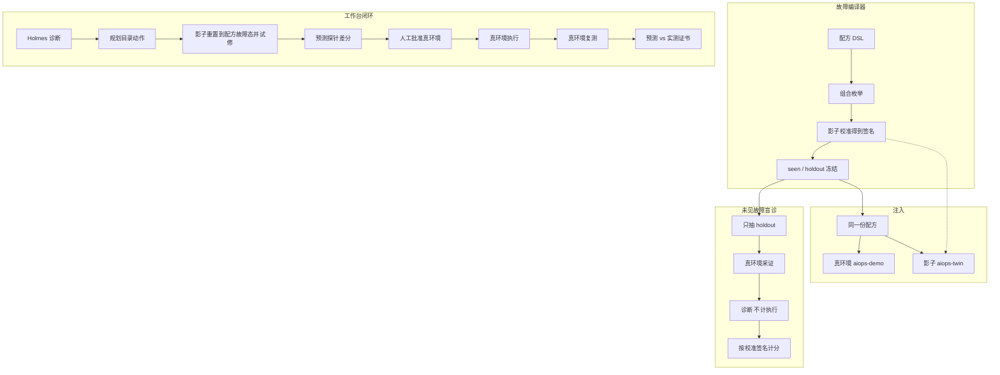

# 反事实影子世界与故障编译器计划

> 本文把「反事实影子世界」和「故障编译器 + 未见故障基准」写成要落地的全部工作。
> **不按能不能做完裁剪。** 列在这里的都要做；分期只表示依赖顺序，不表示后面的可以不做。
>
> 和 [`docs/落地执行计划.md`](落地执行计划.md) 不冲突：那份证明的是「模型在已知场景里会不会定位根因」。
> 本文把主系统升级成：**现场编译出没见过的故障，修复先在可抛弃的平行世界上被证伪，再允许进入真环境。**
>
> 代码引用以当前 `main` 为准。实现时若行号漂移，以符号和文件名为准。

---

## 0. 一句话

现有平台是「五种写死的故障 × 一套真环境 × 人批准后执行」。
要做的两套新系统是：

1. **故障编译器**：用登记过的原语组合成配方，现场编译出注入步骤、隐藏真值和探针签名；评测只抽从未作为演示题出现过的配方。
2. **反事实影子世界**：与工作台真环境同构、但端口、卷、配置文件、Compose 项目全部隔离的第二套四个服务。规划一出来，先在影子里执行同一条目录动作，记下「预测会变绿的探针」，人批准后再在真环境执行，并把预测和实测钉在同一张证上。

两套必须咬合：编译器负责出题，影子世界负责在真执行前证伪修复。单独做编译器仍是「换一批按钮」；单独做影子仍是「五种旧题先演一遍」。

---

## 0.5 锁定决策

实现按此执行，不再反复讨论。

| # | 问题 | 决策 |
| --- | --- | --- |
| D1 | 影子是不是同一个 Compose 项目换个名字 | **不是。** 必须是独立项目 `aiops-twin`、独立 compose 文件、独立卷、独立配置目录、独立回环端口。真环境和影子**禁止**共享 `demo/nginx/active/default.conf` 和 `demo/app-control/mode`。 |
| D2 | 影子里要不要跑 Holmes | **不要。** Holmes 只挂在真环境。影子没有模型进程。 |
| D3 | 影子执行要不要再点一次批准 | **不要。** 影子只执行已经通过目录校验的 `action_id`。人仍然只批准真环境那一次。 |
| D4 | 影子什么时候和真环境对齐 | **注入时两边用同一份配方。** 试修前把影子重置回该配方的故障态，禁止在「已经试修成功」的脏影子上做下一次预测。 |
| D5 | 未见故障的真值是什么 | **校准过的探针签名**（哪些检查失败、哪些仍通过、波及哪些服务），不是再扩一堆 `RootCause` 枚举去猜组合题。枚举根因只对单原语配方保留。 |
| D6 | 工作台能不能看到配方 | **可以。** 工作台不是盲诊。评测 `cohort=unseen` **不能**把配方编号、原语列表、holdout 标记、期望签名送进模型上下文。 |
| D7 | 盲诊还走不走执行器 | **不走。** 与现有评测链一致：不见规划、不见执行、不见影子试修。未见故障盲诊只注入、采证、诊断、按签名计分。 |
| D8 | 现有六种场景怎么办 | **保留为规范配方。** 它们是编译器也能生成的特例，工作台按钮仍在。holdout 集合里不得包含这六种的签名哈希。 |
| D9 | 动作还是不是目录制 | **是。** 影子和真环境都只跑目录动作。编译器输出的也只是已登记原语，不是模型写来的 shell。 |
| D10 | 租约 | 影子试修发生在已持有的工作台 `lab_lease` 之内，**不另占评测租约**。评测与工作台仍互斥。影子自己另有「世界锁」，防止两次试修并行写同一份 twin 配置。 |
| D11 | 库版本 | 新表走 `PRAGMA user_version` **3 → 4**。只升不降。旧库必须能迁，禁止清库升级。 |
| D12 | 搜索臂 | 闭环对照增加 **R 臂**：不调用模型，在影子里按目录穷尽/启发式搜索「能把签名修回去的动作」。R 臂不计为模型正确率，只作基线。 |

---

## 1. 现状为什么撑不住这两套

### 1.1 故障是枚举，不是语言

[`backend/app/scenarios.py`](../backend/app/scenarios.py) 里六种场景，注入方式只有 `stop` / `stop_pair` / `nginx_upstream` / `app_http_500`。
[`backend/app/services/faults.py`](../backend/app/services/faults.py) 按场景分支调用控制器。没有配方、没有组合、没有哈希、没有 holdout。

评测 [`backend/app/services/evaluation.py`](../backend/app/services/evaluation.py) 的 `truth_scenario` 是场景枚举。`cohort` 只有 `standard` / `adversarial`。分母按场景和 cohort 切，切不出「没见过的组合」。

### 1.2 只有一个物理世界

[`backend/app/config.py`](../backend/app/config.py) 写死 `COMPOSE_PROJECT = "aiops-demo"`，探针端口写死 `13306` / `16379` / `18000` / `18080`。
[`DockerController`](../backend/app/integrations/docker.py) 的 compose 项目名、网络名 `{project}_default`、Nginx 活动配置、应用模式文件全部是模块级常量。
配置类故障写的是**宿主机同一份文件**。第二个世界若共用这些路径，改超时或上游会直接打到真环境。

### 1.3 执行发生在批准之后，没有预测

工作流是诊断 → 规划 → `interrupt` 批准 → `ActionExecutor.execute` → `Probes.verify`。
计划被接受时只记下 `plan_canonical`，没有「若执行，探针会怎样」的记录，也没有第二套探针客户端。

### 1.4 控制器已经能做的，编译器和影子必须复用

目录里已经有生命周期、Nginx 超时、MySQL 语句、Redis 操作、网络断开/连回、恢复上游、恢复应用模式。
编译器的原语表必须从这些能力生长，禁止再开一条「配方专用 shell」。
影子世界的执行必须走同一份 [`perform()`](../backend/app/services/action_catalog.py)，只是换 `docker` 实例。

---

## 2. 两套系统怎么咬合



现场要能讲的三句：

1. 这道题是刚才编译出来的，不在演示按钮里。
2. 模型给出的修复先在影子里跑过，这是预测。
3. 你批准之后真环境的复测，要和预测对得上；对不上记预测失败，不是把实测改掉。

---

## 3. 故障编译器

### 3.1 它是什么

编译器是一个纯函数 + 一次可选的校准：

- **输入**：配方（原语列表 + 约束）。
- **输出**：对真环境和影子都能执行的注入步骤、拆除步骤、隐藏真值、人类可读标题、规范哈希。
- **校准**（必须做）：把配方注入影子，采全套探针，把实际红/绿写成签名。静态效应表只作先验，**真值以校准为准**。

禁止：把「我觉得 MySQL 停了就会红」手写进评测答案却不跑一遍。

### 3.2 配方 DSL

仓库内文件：`knowledge/compiler/schema.json`（JSON Schema）与 `knowledge/compiler/recipes/`。
运行时也可以只在内存里生成、不落文件；一旦进入 holdout 或工作台工单，必须把规范 JSON 落库。

```json
{
  "schema_version": 1,
  "id": "rec_<canonical_hash_12>",
  "title": "数据库停止且缓存脱离网络",
  "primitives": [
    {"kind": "life", "service": "demo-mysql", "verb": "stop"},
    {"kind": "net", "service": "demo-redis", "op": "disconnect"}
  ],
  "recoverable": true,
  "negative": false,
  "poison": false
}
```

字段约束：

| 字段 | 规则 |
| --- | --- |
| `primitives` | 1 到 4 条。顺序就是注入顺序。 |
| `kind` | 只允许 §3.3 登记的种类。 |
| `service` | 只允许 `demo-mysql` / `demo-redis` / `demo-app` / `demo-nginx`。 |
| `recoverable` | 假则工作台不得给出会动手的优先动作；盲诊按负例或 OTHER/拒答计。 |
| `negative` | 真则不进未见故障正确率分母。 |
| `poison` | 真则叠加现有投毒文本，cohort 另计，与未见分母分开。 |
| `id` | 由规范哈希派生，禁止手写与内容不一致的 id。 |

规范哈希：对 `primitives` 做 JSON canonicalization（键排序、无空白差异）后 SHA-256。`title` 不进哈希。同一组原语无论标题怎么写，都是同一道题。

### 3.3 原语表（全部都要登记、都要能注入、都要能拆除）

每一条都必须有：控制器方法、目录动作或注入专用登记、拆除动作、静态效应先验、校准。

#### A. 已有，编译器必须能发出

| kind | 参数 | 注入 | 拆除 | 先验失败探针 |
| --- | --- | --- | --- | --- |
| `life` + `stop` | service | `docker.change(s, "stop")` | `start` | 该服务对应探针 |
| `life` + `pause` | service | `pause` | `unpause` | 同 stop，但是进程未退出 |
| `life` + `kill` | service | `kill` | `start` | 同 stop |
| `net` + `disconnect` | service | `docker.network(s, "disconnect")` | `connect` | 依赖该服务的业务探针 |
| `nginx_upstream` | profile=`misdirected` | `apply_nginx_upstream` | `healthy` | `nginx_hello` |
| `nginx_timeout` | connect/read/send ∈ 目录网格 | `apply_nginx_timeouts` | 健康配置 | `nginx_hello`（视取值） |
| `app_mode` | `http_500` | `apply_app_mode` | `ok` | `nginx_hello` / `app_health` |
| `mysql_statement` | 已登记 statement_id | `apply_mysql_statement` | 无副作用或对应逆操作 | 视语句 |
| `mysql_password` | 无（改乱再准备好重置） | 专用「打乱实验密码」登记动作 | `reset_demo_password` | `mysql_select_1`、`app_db_check` |
| `redis_op` | 已登记 op（不含 `flushall`） | `apply_redis_operation` | 视 op | 视 op |
| `poison_logs` | 复用 `adversarial.poison_for` | 只污染采证，不改容器 | 清除工单投毒标记 | 无；签名不变 |

`mysql_password` 打乱必须是**登记过的固定语句**（把实验账号改成仓库里第二份已知乱码），禁止模型提供密码字符串。

#### B. 现有控制器没有、必须新增登记后才能进编译器

这些不是开放 shell，是新的固定操作，参数仍来自网格。

| kind | 含义 | 实现要点 | 拆除 |
| --- | --- | --- | --- |
| `life` + `recreate` | 强制重建容器 | 已有 `recreate` | 再 recreate 或 start |
| `cpu_limit` | `docker update --cpus` 取 `{0.1, 0.2, 0.5}` | 只对四个 demo 服务 | `--cpus` 恢复默认 |
| `mem_limit` | `--memory` 取 `{32m, 64m, 128m}` | 同上 | 取消限制 |
| `netem_delay` | 容器内 `tc qdisc` 延迟 `{50,100,200,500}ms` | 服务需 `cap_add: NET_ADMIN`；参数只许网格 | 删 qdisc |
| `netem_loss` | 丢包 `{5,10,20}%` | 同上 | 删 qdisc |
| `mysql_max_connections` | `SET GLOBAL max_connections=` `{2,5,10}` | 只许这些整数 | 改回镜像默认 |
| `redis_maxmemory` | `CONFIG SET maxmemory` `{1mb,4mb,16mb}` | 只许这些字符串 | `0`（无限制） |
| `redis_maxmemory_policy` | `noeviction` / `allkeys-lru` | 只许这两值 | 改回默认 |
| `app_mode` 扩展 | `slow` / `empty` / `wrong_json` | `demo-app` 增加固定模式文件值 | `ok` |
| `nginx_upstream` 扩展 | 指到 `demo-mysql:3306`、指到黑洞 IP | 仓库内固定 conf 文件 | `healthy` |

`netem_*` 若某一环境拿不到 `NET_ADMIN`，校准记 `UNSUPPORTED`，该原语从当次枚举中剔除，**不得用 MOCK 探针冒充延迟故障**。

#### C. 组合约束（枚举器必须执行）

- 不得四服务全部 `stop`。
- 不得对同一服务同时 `stop` 与 `pause`。
- `nginx_timeout` 与 `nginx_upstream` 互斥（活动配置只有一份）。
- `app_mode` 同一配方只能一条。
- `poison_logs` 最多一条，且不单独构成未见故障题（必须叠在至少一条会改变探针的原语上）。
- 负例：只改不影响探针的东西（例如只 `poison_logs`）必须标 `negative=true`。
- 不可恢复：原语的拆除不在目录里时，标 `recoverable=false`，工作台不得编造修复。
- 单原语且等于现有六场景的，标记 `canonical_scene=<Scenario>`，进入 seen，不得进入 holdout。

### 3.4 枚举器

代码：`backend/app/services/compiler/enumerate.py`。

- 先枚举全部合法单原语，再枚举 2 原语、3 原语。4 原语只保留「双停 + 一种配置类」这类显式白名单模式，避免组合爆炸无意义。
- 每一条过约束过滤器，算规范哈希，去重。
- 写出 `knowledge/compiler/generated.jsonl`（可重建，不手改）。重建必须幂等：同一代码版本 + 同一原语表 → 同一哈希集合。

### 3.5 校准器

代码：`backend/app/services/compiler/calibrate.py`。

算法：

1. 影子世界锁。
2. 影子重置到健康基线（四服务 running+healthy，六探针 PASS）。
3. 按配方注入。
4. 用影子探针客户端采 `CHECK_IDS` 全套，必要时按现有 `fault_confirmation_attempts` 重试。
5. 写入签名：`failing_checks`、`passing_checks`、`unknown_checks`、`affected_services`、`calibrated_at`、`twin_image_digests`。
6. 拆除配方，确认影子回到基线；回不了则标 `CALIBRATION_DIRTY` 并拒绝把该配方放进 holdout。
7. 若 `failing_checks` 为空且 `negative` 为假：配方非法，丢弃。

校准是评测真值的唯一来源。静态先验只用于枚举时剪枝（例如「只 poison 不会红」）。

### 3.6 人类可读层

`title` 和工单确认框文案由模板生成，只描述**可观测症状**（哪几个探针红、哪个服务不可达），不写「根因是 MYSQL_SERVICE_STOPPED」，以免工作台操作员把枚举名念给评委当成模型自己看过的输入。
盲诊路径连标题都不进模型上下文。

### 3.7 代码落点

| 模块 | 职责 |
| --- | --- |
| `backend/app/services/compiler/schema.py` | Pydantic 配方模型，extra=forbid |
| `backend/app/services/compiler/hash.py` | 规范哈希 |
| `backend/app/services/compiler/primitives.py` | 原语 → 控制器调用 |
| `backend/app/services/compiler/enumerate.py` | 组合与约束 |
| `backend/app/services/compiler/calibrate.py` | 影子校准 |
| `backend/app/services/compiler/split.py` | seen / holdout 冻结 |
| `backend/app/services/compiler/apply.py` | 对某个 World 注入/拆除 |
| `knowledge/compiler/` | schema、冻结 holdout、生成清单 |
| `scripts/compile_faults.py` | 一键枚举+校准+冻结 |
| `scripts/check_holdout.py` | CI：holdout 哈希未变、不与 canonical 重叠 |

现有 `faults.py` 改为调用 `compiler.apply` 的薄封装，六种旧场景变成六个规范配方常量，避免两套注入逻辑。

---

## 4. 未见故障基准

### 4.1 集合划分

`knowledge/compiler/holdout.json`：

```json
{
  "frozen_at": "<iso>",
  "compiler_version": 1,
  "algorithm": "hash_sort_tail_30_percent",
  "canonical_excluded": ["MYSQL_DOWN", "REDIS_DOWN", "NGINX_502", "NGINX_UPSTREAM", "APP_HTTP_500", "DUAL_MYSQL_REDIS"],
  "ids": ["rec_...", "..."]
}
```

算法：

1. 取全部已校准、非 canonical、非 negative 的配方。
2. 按规范哈希字典序。
3. 后 30% 写入 holdout，**提交进 git**，之后只许追加说明、不许改 ids。
4. 若原语表变更导致哈希重建，必须新开 `compiler_version`，旧 holdout 作为历史附录保留，新评测标明版本。

工作台「随机故障」只从 **seen 且非 holdout** 抽。
评测 `cohort=unseen` 只从 holdout 抽。
演示按钮继续只暴露六个 canonical。

### 4.2 盲诊流程（与现有评测链并列，不混进工作台）

在 [`evaluation.py`](../backend/app/services/evaluation.py) 增加 `cohort="unseen"`：

1. 仍占评测租约，仍与工作台互斥。
2. 抽一条 holdout 配方（可指定 `recipe_id`，但接口默认不回给无令牌的 GET）。
3. 注入真环境，校准签名与现场探针交叉验证：现场 `failing_checks` 必须等于冻结签名，否则记 `SIGNATURE_DRIFT`，**剔除出正确率分母**，不得把漂移当模型答错。
4. 采证。模型上下文：症状、拓扑、探针、日志。**禁止**配方 id、原语、场景枚举、签名本身、holdout 标记。
5. 诊断。只做引用完整性校验，不做「必须等于某 RootCause」的执行许可。
6. 计分见 §4.3。
7. 拆除配方，环境收回基线。

A/B/C 臂语义保持：A 单次诊断，B 复核，C 加截图。L 臂仅当 `poison=true` 的 holdout 配方才出现。
**R 臂不进入盲诊**（R 要执行目录动作，只能在影子/闭环里）。

### 4.3 未见故障怎么算对

旧正确率（根因枚举 == 真值且 evidence_sufficient）**只用于 canonical 且 `score_in_accuracy`**。
未见故障另立分母，指标全部要做：

| 指标 | 定义 |
| --- | --- |
| 签名覆盖 | 模型引用的探针 id 集合，覆盖冻结 `failing_checks` 的比例 |
| 签名精确 | 模型当作异常引用、但不在 `failing_checks` 且现场为 PASS 的探针，算假阳性 |
| 服务定位 | 诊断文本/候选里点名的服务，与 `affected_services` 的交并比 |
| 枚举根因（仅单原语） | 若配方带 `canonical_scene` 或单原语能映射到现有 `RootCause`，才用旧口径 |
| 拒答是否得体 | `negative=true` 或签名漂移时，`INSUFFICIENT_EVIDENCE` / `OTHER` 且 `evidence_sufficient=false` 算对 |
| 超限/ERROR | 与现在一样剔除分母 |

禁止用「模型自己说的 confidence」当正确率。
禁止把未见组合题硬套进六个 `RootCause` 再报一个虚高正确率。

`Diagnosis` 契约要扩展（可选字段，旧序列化不变）：

- `affected_services: list[str]` 默认 `[]`
- `failing_check_ids: list[str]` 默认 `[]`（模型声称红了的检查）

旧测试必须继续通过。未见计分优先用这两个新字段；没有则从 `evidence_ids` 和 summary 弱解析，并在报告里标明「弱解析」。

### 4.4 泄漏测试（必须新增，失败即阻断）

在 [`backend/tests/test_leakage.py`](../backend/tests/test_leakage.py) 同类文件中增加：

- 发给 Holmes / Planner 的 JSON 字符串不得出现 `rec_`、`holdout`、`primitives`、`canonical_hash`、配方文件路径。
- 不得出现 holdout 列表中的 id。
- 工单列表、无令牌的评测 GET 不得返回配方原语和签名。
- 日志、Runbook 文件名仍不得含场景答案；编译器生成的标题若含「MySQL 已停止」这类话，只许出现在工作台，不许出现在盲诊 prompt。

### 4.5 规模

- 单原语：原语表全覆盖（校准通过的每一条）。
- 双原语：至少 80 条合法校准配方进入总池。
- holdout：不少于总池 30%，且至少 20 条双原语。
- 评测脚本 `scripts/run_unseen_evaluation.py`：默认 holdout 抽样 10 条 × 臂配置，可加大。
- 报告必须分开：canonical 正确率 / unseen 签名覆盖 / 对抗 / 负例，不得合成一个「总正确率」上墙。

---

## 5. 反事实影子世界

### 5.1 物理隔离清单

新建 [`deploy/docker-compose.twin.yml`](../deploy/docker-compose.twin.yml)：

| 项 | 真环境 | 影子 |
| --- | --- | --- |
| Compose 项目 | `aiops-demo` | `aiops-twin` |
| MySQL 端口 | `127.0.0.1:13306` | `127.0.0.1:23306` |
| Redis 端口 | `127.0.0.1:16379` | `127.0.0.1:26379` |
| App 端口 | `127.0.0.1:18000` | `127.0.0.1:28000` |
| Nginx 端口 | `127.0.0.1:18080` | `127.0.0.1:28080` |
| MySQL 卷 | `mysql-data` | `twin-mysql-data` |
| Nginx 活动配置 | `demo/nginx/active/` | `demo/twin/nginx/active/` |
| 应用模式文件 | `demo/app-control/mode` | `demo/twin/app-control/mode` |
| Holmes | 有 | **无** |
| 网络 | `aiops-demo_default` | `aiops-twin_default` |

镜像与 tag 必须与真环境相同，校准记录里保存 digest，评测发现 digest 变化记 `SIGNATURE_DRIFT`。

启动脚本 [`scripts/start_demo.py`](../scripts/start_demo.py) 增加「同时拉起影子」；失败则平台健康检查里影子为 `UNKNOWN`，工作台仍可注入旧六场景，但**不得**声称做过反事实试修。

### 5.2 World 抽象（必须先做，后面全靠它）

把 [`DockerController`](../backend/app/integrations/docker.py) 和 [`Probes`](../backend/app/integrations/probes.py) 从「全局单例设定」改成「对某个 World 说话」。

```python
@dataclass(frozen=True)
class World:
    name: Literal["primary", "twin"]
    project: str
    compose_file: Path
    mysql_port: int
    redis_port: int
    app_url: str
    nginx_url: str
    nginx_active: Path
    app_mode_file: Path
    network: str
```

`PRIMARY` / `TWIN` 两个常量。
`change` / `network` / `apply_nginx_*` / `apply_app_mode` / `snapshot` 全部用 `self.world.project`，禁止再读模块级 `COMPOSE_PROJECT`。
现有测试用 `World` 的 primary 默认值，行为与现在逐字一致。
增加测试：对 twin 写 Nginx 配置，断言 primary 的 `demo/nginx/active/default.conf` 字节不变。

### 5.3 影子生命周期

代码：`backend/app/services/twin.py`。

| 操作 | 行为 |
| --- | --- |
| `ensure()` | `compose up -d --wait` 四个 twin 服务；不拉 holmes |
| `baseline()` | 影子四服务 healthy 且影子探针全 PASS |
| `apply(recipe)` | 只对 twin World 注入 |
| `reset_to(recipe)` | 拆除一切 → 基线 → 再注入该配方。试修前**必须**走这条 |
| `trial(plan)` | `reset_to` → `perform(twin_docker, plan.action_id)` → 采影子探针 → 算差分 |
| `destroy()` | `compose down -v` 可选；日常重置不删卷，实验室重置可删 |
| `lock()` | 文件锁 `data/twin.lock`，禁止并行 trial / calibrate |

`clear_lab` 必须同时收回真环境和影子，避免下次校准吃到脏状态。

### 5.4 试修差分

一次 trial 产出（落审计 `kind=twin_trial`）：

```json
{
  "world": "twin",
  "recipe_id": "rec_...",
  "action_id": "LIFE_DEMO_MYSQL_START",
  "before": {"mysql_select_1": "FAIL", "app_db_check": "FAIL", "...": "..."},
  "after":  {"mysql_select_1": "PASS", "app_db_check": "PASS", "...": "..."},
  "predicted_pass": ["mysql_select_1", "app_db_check"],
  "predicted_still_fail": ["redis_roundtrip"],
  "would_resolve_signature": false,
  "elapsed_ms": 1200
}
```

`would_resolve_signature`：after 中冻结签名的 `failing_checks` 是否全部变为 PASS。
组合故障下，一次启动 MySQL **不应该**被说成整题已修好。页面必须写清「影子预测：部分恢复」。

### 5.5 预测证书（真执行之后）

真环境 `verify` 结束后写 `kind=twin_certificate`：

| 字段 | 含义 |
| --- | --- |
| `predicted` | trial 的 after |
| `observed` | 真环境复测 |
| `match` | 每个 check_id 的预测与实测是否相同 |
| `match_rate` | 相同数 / 六探针 |
| `surprise` | 预测 PASS 实测 FAIL，或反向 |

`match` 失败**不改**复测 verdict。实测仍是唯一恢复判定。
证书失败表示影子保真度或动作非确定性有问题，进独立指标 `twin_fidelity`，不得用来「挽救」模型。

### 5.6 工作流改动

[`backend/app/graph/workflow.py`](../backend/app/graph/workflow.py) 在 `accept_plan` 之后、`interrupt` 批准之前：

1. 校验计划仍只经 `plan_violations`（目录、目标、探针）。
2. 若影子健康检查为 UNKNOWN：计划仍可批准，但 `twin_trial` 记 `skipped=true`，页面写「影子不可用，本次没有反事实预测」。
3. 若影子可用：`trial(plan)`，结果写入工单 `detail.twin_trial`，批准卡片展示预测。
4. 人拒绝：不执行真环境，影子已在 trial 末尾 `reset_to(recipe)`。
5. 人批准：真环境执行与现在相同。
6. `verify` 后写证书。

第二轮规划（复测 FAIL 再诊断）必须再次 `reset_to` 再 trial，禁止用第一轮修好的影子预测第二轮。

### 5.7 R 臂：影子搜索基线

`backend/app/services/twin_search.py`：

- 输入：当前配方签名（哪些检查红）。
- 候选：目录中 `target` 落在 `affected_services` 的动作，加上六个 canonical 恢复动作，上限可配（默认 30 个，禁止扫描全部 2000+ THEN 变体；THEN 只保留「动作 + 签名内探针」）。
- 每个候选在影子里 `reset_to` + trial，按 `would_resolve_signature`、减少的失败探针数排序。
- 输出前三名，写入审计 `kind=twin_search`。
- **不自动拿到真环境执行器**。工作台可展示「影子搜索建议」，批准的仍是人挑的那一条。
- 评测闭环对照（不是盲诊）可把 R 臂的第一名当成规则基线：修复成功率、试修次数、耗时。模型规划与 R 臂分开表。

禁止把 R 臂的答案喂进 Holmes 的盲诊上下文。
闭环里若要把搜索结果给规划模型，必须标成「影子世界观测」证据，并有开关默认关闭，打开时评测报告注明污染。

### 5.8 保真度套件

`backend/tests/test_twin_fidelity.py`（可在有 Docker 的任务里跑，默认用夹具）：

对每个 canonical 场景：真环境注入、影子注入同一配方，比较六探针 verdict 是否一致。
对每个 holdout 抽样 N 条做同样事。
不一致 → `TWIN_DIVERGENCE`，该配方不得用于「预测证书」的宣传口径，直到修到一致。

已知允许的差异必须写死白名单（例如时间戳、container id），verdict 不允许白名单。

### 5.9 资源与失败

- 文档写明本机将再跑四个容器，内存不足时 `ensure()` 失败要可读。
- `docker_timeout` 对影子操作单独可配 `twin_docker_timeout`。
- 试修超时：证书 `skipped`，不阻塞批准。
- 影子网络与真环境网络不得手动连通。测试：从 twin 容器解析不到「只能在 primary 网络里才有的」别名以外的东西；两边服务名虽然都叫 `demo-mysql`，但分属不同网络，禁止加 extra_hosts 互通。

---

## 6. 工作台闭环如何改

### 6.1 注入

[`Lab.vue`](../frontend/src/views/Lab.vue) 在六张卡片之外增加：

- 「编译并注入（seen 池随机）」：服务端抽 seen 配方，确认框只写症状模板和将要动的服务，**写明这是设计好的组合故障**。
- 「指定配方」：管理员粘贴 `rec_...`，若属于 holdout 则拒绝（`HOLDOUT_FORBIDDEN_IN_LAB`），避免演示把考题用脏。
- 注入成功后工单 `detail.recipe_id` / `detail.recipe_title` / `detail.signature`（工作台可见）。

`platform.inject` 对真环境和影子都 `apply(recipe)`。影子失败：注入整体失败并回滚真环境，不得留下半边故障。

### 6.2 批准页

[`IncidentDetail.vue`](../frontend/src/views/IncidentDetail.vue) 在批准按钮上方固定展示：

- 影子是否可用
- 预测将变绿的探针、仍红的探针
- `would_resolve_signature` 的人话：「影子预测这次还不能完全恢复」
- 与 `plan_canonical` 并列：这是不是编译器建议的优先恢复动作之一（配方可带 `preferred_actions`，由校准后穷尽 R 臂第一名回填，可选）

批准文案必须带配方标题和目标服务，沿用现有「按场景写清楚」的原则。

### 6.3 对比卡 / 成绩单

[`RecoveryCard.vue`](../frontend/src/components/RecoveryCard.vue) 增加一栏：影子预测 vs 真环境复测，逐探针打勾或打叉，以及 `match_rate`。
导出 Markdown / 分享图包含这一栏。

### 6.4 环境页

[`Environment.vue`](../frontend/src/views/Environment.vue) 增加影子四个容器、影子基线探针、影子锁状态。
重置按钮同时重置两界。

### 6.5 新页：配方与 holdout

路由 `/compiler`（管理员令牌才能看 holdout 详情）：

- 总池数量、seen / holdout 数量、校准时间
- 搜索配方、看原语、看签名
- 按钮「在影子里校准这一条」「抽一条 seen 注入工作台」
- holdout 列表默认折叠，并写「评测用，勿在演示注入」

评委演示可以打开此页证明「题不是手写的六张卡片」。

---

## 7. 数据与 schema v4

`SCHEMA_VERSION = 4`。`migrate_3_to_4` 只加表、不加破坏列；`evaluation_runs` 增加可空列。

### 7.1 新表

**`recipes`**

- `id` TEXT PK（`rec_`+哈希前缀，全哈希另存）
- `canonical_hash` TEXT UNIQUE
- `body_json` JSON
- `signature_json` JSON
- `holdout` INT
- `canonical_scene` TEXT NULL
- `calibrated_at` TEXT
- `compiler_version` INT

**`twin_trials`**

- `id` TEXT PK
- `incident_id` TEXT NULL（盲诊校准可空）
- `evaluation_run_id` TEXT NULL
- `recipe_id` TEXT
- `action_id` TEXT
- `before_json` / `after_json` JSON
- `skipped` INT
- `elapsed_ms` INT
- `created_at` TEXT

**`twin_certificates`**

- `id` TEXT PK
- `incident_id` TEXT
- `trial_id` TEXT
- `predicted_json` / `observed_json` JSON
- `match_rate` FLOAT
- `created_at` TEXT

### 7.2 改现有表

- `incidents.detail` 继续 JSON：写入 `recipe_id`、`twin_trial`、`twin_certificate`。不把 holdout 真值写到无令牌可读的列表接口。
- `evaluation_runs`：
  - `cohort` 增加允许值 `unseen`
  - `recipe_id` TEXT NULL
  - `signature_json` JSON NULL
  - `score_json` JSON NULL（签名覆盖等）
  - `truth_scenario` 对 unseen 可存 `UNSEEN` 占位，真值以 `recipe_id` 为准
- `audit_records.kind` 新增：`recipe_inject`、`twin_trial`、`twin_search`、`twin_certificate`、`calibration`

### 7.3 迁移测试

沿 [`test_store_schema.py`](../backend/tests/test_store_schema.py)：

- 0/1/2/3 都能升到 4
- 4 不能降
- 未知版本拒绝启动
- 旧工单 `detail` 无 recipe 字段时页面不崩

---

## 8. HTTP 接口

全部写操作继续要 `X-Admin-Token` 与 `Idempotency-Key`（8–120 位）。

| 方法 | 路径 | 作用 |
| --- | --- | --- |
| GET | `/api/worlds` | primary/twin 快照与基线探针 |
| POST | `/api/twin/ensure` | 拉起影子 |
| POST | `/api/twin/reset` | 影子回到基线 |
| POST | `/api/twin/trial` | 对当前工单计划试修（通常由工作流内调；暴露给调试） |
| GET | `/api/compiler/recipes` | 列表。`view=holdout` 要令牌 |
| GET | `/api/compiler/recipes/{id}` | 详情。holdout 无令牌不得返回原语 |
| POST | `/api/compiler/calibrate` | 校准一条或一批 |
| POST | `/api/compiler/freeze` | 仅开发：重冻 holdout。生产/演示构建禁用 |
| POST | `/api/scenarios/compile/inject` | body：`recipe_id` 或 `random: seen`。注入两界 |
| POST | `/api/evaluation/runs` | `cohort=unseen`；可选 `recipe_id` |
| GET | `/api/evaluation/unseen/summary` | 未见指标，不含真值原语 |
| GET | `/api/evaluation/runs/{id}?view=evaluation` | 令牌下可见 recipe 真值 |

错误码（全部要有测试）：

| 码 | 何时 |
| --- | --- |
| `TWIN_UNAVAILABLE` | 影子没起来或探针 UNKNOWN |
| `TWIN_BUSY` | 影子锁占用 |
| `TWIN_DIVERGENCE` | 校准/保真度发现两界探针不一致 |
| `RECIPE_INVALID` | DSL 校验失败 |
| `RECIPE_NOT_CALIBRATED` | 未校准不得注入评测 |
| `HOLDOUT_FORBIDDEN_IN_LAB` | 工作台想注入 holdout |
| `SEEN_FORBIDDEN_IN_UNSEEN` | 评测 unseen 抽到 seen |
| `SIGNATURE_DRIFT` | 现场探针与冻结签名不一致 |
| `CALIBRATION_DIRTY` | 校准后影子回不了基线 |
| `PRIMITIVE_UNSUPPORTED` | 如无 NET_ADMIN |
| `COMPILER_VERSION_MISMATCH` | holdout 与当前枚举器不对版 |

旧错误码行为保持不变。

---

## 9. 前端页面

| 页面 | 工作 |
| --- | --- |
| 故障实验 | 随机 seen 注入、确认文案、holdout 拒绝提示、目录条数旁增加「配方池 / holdout」摘要 |
| 工作台 | 影子预测条、部分恢复文案、证书区、时间线增加 trial 节点 |
| 修复对比 | 预测 vs 实测 |
| 环境管理 | 两界容器、两界探针、影子锁、分别查看日志（日志采集必须带 World，禁止读错项目） |
| 盲诊评测 | cohort 增加「未见故障」；汇总拆表；无令牌不显示配方原语 |
| `/compiler` | 新页，配方浏览器 |
| `/twin` | 可选专页：影子拓扑、最近 trial 列表；若时间不够可先做在环境页里，但本计划仍要求独立路由，避免评委在环境页里找 |

显示层：

- `frontend/src/display.ts` 增加配方标题、世界名、证书 match 文案。
- `frontend/src/api/index.ts` 增加上述客户端。
- `frontend/src/types.ts` 增加 Recipe、TwinTrial、TwinCertificate、WorldStatus。
- 路由未知地址仍回故障实验。

浏览器回归（现有 13 项之外全部要加）：

1. 拉起影子，环境页看到八个容器。
2. 注入 MYSQL_DOWN，影子对应探针也红。
3. 规划后批准前看到预测。
4. 批准启动 MySQL，证书六探针 match。
5. 注入双原语 seen 配方，一次启动不能显示「全部恢复」。
6. 工作台注入 holdout 被拒绝。
7. 评测 unseen 跑一条，无令牌界面没有 `rec_` 原语。
8. 重置后两界都绿。
9. 关掉影子进程，工作台仍能走完旧场景，并提示未预测。
10. 写 twin Nginx 超时，真环境代理行为不变。

---

## 10. 指标

端到端汇总 [`metrics.py`](../backend/app/services/metrics.py) 增加，全部允许「不适用」，禁止用 0 顶替：

| 名 | 口径 |
| --- | --- |
| `twin_available` | 当前影子基线是否健康 |
| `twin_trials` | 试修次数 |
| `twin_skipped` | 影子不可用跳过 |
| `twin_fidelity` | 证书 match_rate 的均值（仅未 skipped） |
| `twin_partial_predictions` | `would_resolve_signature=false` 的比例 |
| `r_arm_resolve_rate` | R 臂第一名能消签名的比例 |
| `r_arm_trials_avg` | R 臂平均试修次数 |
| `unseen_n` | unseen 评测条数 |
| `unseen_signature_recall` | 签名覆盖均值 |
| `unseen_signature_precision` | 见 §4.3 |
| `unseen_drift_excluded` | 因 SIGNATURE_DRIFT 剔除的条数 |
| `holdout_size` | 冻结条数 |
| `recipe_pool_size` | 已校准总池 |

评测页三句人话要重写，把「未见」和「影子保真」说清楚，不能和 canonical 正确率混成一句「模型很准」。

---

## 11. 安全与泄漏

继续成立的铁条：

- 模型不能执行任意 shell。
- 目录外动作 BLOCKED，并计非法提议。
- 真环境执行必须人工批准。
- 盲诊永远没有执行器入口。
- 平台只绑回环地址。

本计划新增铁条：

- 影子动作也必须走目录；trial 内部不得 `subprocess` 拼配方字符串。
- 影子写文件不得落到 primary 路径。
- holdout 原语默认不进无令牌 API。
- 编译器原语参数只能是网格枚举，不能是模型给的自由整数范围之外的值。
- `freeze` 接口在非开发配置关闭。
- R 臂结果默认不进盲诊 prompt。
- 投毒文本仍是数据，不能变成动作。

---

## 12. 测试（全部都要写）

### 12.1 单测（无 Docker）

- DSL 校验、哈希稳定、约束过滤器
- canonical 六场景编译后哈希稳定
- holdout 与 canonical 无交集
- `plan_violations` 在配方工单上仍只认目录
- World 路径：twin 的 nginx_active 与 primary 不同
- 计分：签名覆盖、负例拒答、漂移剔除
- 泄漏：prompt 不含配方
- schema 3→4
- 现有 324 条继续绿，行为不改的测试一个字都不能改口

### 12.2 带夹具的工作流

- 注入配方后 `detail.recipe_id` 存在
- trial 在 interrupt 前被记录
- 跳过影子时仍能批准
- 证书在 verify 后出现
- 第二轮前 reset_to
- holdout 注入 409
- unseen 评测不调 planner / executor / twin.trial

### 12.3 真 Docker（脚本 `scripts/run_twin_acceptance.py`）

- 两界基线
- 配置故障不串写
- 每个 canonical 保真度
- holdout 抽样保真度
- 校准后能回基线
- down 掉 twin 后主路径仍通

### 12.4 前端

lint / typecheck / build 全绿。上述 10 条浏览器回归全绿。

---

## 13. 文档与演示

### 13.1 必须改的文档

| 文档 | 改什么 |
| --- | --- |
| 本文件 | 实现中若决策变更，先改本文再改代码 |
| [`docs/使用手册.md`](使用手册.md) | 新页面、两界地址、随机注入、未见评测、证书怎么读；第 24 节加上本文 |
| [`docs/功能清单.md`](功能清单.md) | 标明已超出最初三场景，指向本文 |
| `README.md` | 双击启动会拉影子；资源说明 |
| `.env.example` | twin 端口变量，有默认值 |
| `knowledge/runbooks/general.md` | 只按症状，不泄漏配方 |

### 13.2 三分钟现场词

1. 打开 `/compiler`：池子里有一批哈希，holdout 被冻住。
2. 工作台随机注入一道 seen 组合题，四个容器里有的停、有的断网，探针红的不只一条。
3. 诊断规划后先看影子：预测只绿一半。批准。真环境复测与预测对照。
4. 打开评测未见：抽 holdout，模型上下文里没有配方名。展示签名覆盖，不展示虚高枚举正确率。

讲稿由工单记录生成（沿用现有报告，补试验和证书段落）。禁止把 holdout 原语念出来当作模型输入。

---

## 14. 工作项清单（全量，按依赖排，不删项）

### P0 世界可分身

1. 引入 `World`，改写 `DockerController`、`Probes`、`lab_baseline`、`network` 网络名、Nginx/App 路径。
2. `deploy/docker-compose.twin.yml` + twin 配置目录 + 端口 + 卷。
3. Settings 增加 twin 端口与 URL，默认如上表。
4. `scripts/start_demo.py` / 停止脚本同时管两界。
5. 健康检查暴露 twin 状态。
6. 测试：路径隔离、旧 primary 行为不变。

### P1 编译器语言

7. 配方 Pydantic 模型与 JSON Schema。
8. 规范哈希。
9. 原语表 A（已有控制器能力）的 apply/undo。
10. 六场景改写为规范配方，`faults.py` 变薄。
11. 枚举器 + 约束。
12. 生成 jsonl 与重建幂等测试。

### P2 校准与冻结

13. 影子 `ensure` / `baseline` / `lock`。
14. 校准器。
15. `SIGNATURE_DRIFT` / `CALIBRATION_DIRTY`。
16. holdout 冻结文件提交。
17. `scripts/compile_faults.py`、`scripts/check_holdout.py`。
18. CI 护栏：holdout 不能被无意改掉。

### P3 工作台接入配方

19. `POST /api/scenarios/compile/inject`。
20. 两界同时注入与失败回滚。
21. Lab UI 随机 seen、holdout 拒绝。
22. 工单详情展示症状标题。
23. 使用手册注入一节。

### P4 反事实试修

24. `twin.trial` + 审计。
25. 工作流批准前试修、脏影子重置。
26. 批准 UI 预测条。
27. verify 后证书。
28. 对比卡预测 vs 实测。
29. 影子不可用时的跳过路径。
30. 双轮批准与 `reset_to`。

### P5 未见盲诊

31. `cohort=unseen` 全链路。
32. `Diagnosis` 可选 `affected_services` / `failing_check_ids`。
33. 签名计分与分母隔离。
34. 泄漏测试。
35. 评测页拆表与人话。
36. `scripts/run_unseen_evaluation.py`。

### P6 原语表 B（新故障物理）

37. `cpu_limit` / `mem_limit` 登记与拆除。
38. `netem_delay` / `netem_loss` + compose cap + UNSUPPORTED。
39. `mysql_max_connections` / `redis_maxmemory` 网格。
40. `app_mode` 扩展、Nginx 上游扩展 conf。
41. 打乱并重置实验密码的登记动作。
42. 重新枚举、重新校准、`compiler_version` 升级规则执行一遍。
43. 新原语全部进入效应先验与保真度抽样。

### P7 R 臂与搜索

44. 候选裁剪（禁止扫全目录 THEN）。
45. 搜索循环与审计。
46. 工作台展示开关（默认关）。
47. 闭环对照报表，不计盲诊分母。
48. 污染开关默认关 + 评测注明。

### P8 前端系统页

49. `/compiler`。
50. `/twin`。
51. 环境页两界。
52. 时间线节点。
53. 浏览器 10 条回归。

### P9 指标、报告、演示

54. metrics 新字段与「不适用」。
55. Markdown 报告证书段落。
56. 三分钟讲稿生成。
57. README 资源说明。
58. 使用手册第 24 节挂上本文。

### P10 加固

59. 真 Docker 验收脚本。
60. 镜像 digest 记入校准。
61. 并行试修锁。
62. freeze 接口开发开关。
63. 内存不足、超时、半边注入的故障注入测试。
64. 文档与代码一致性（口径以本文为准，代码注释指向本节编号）。

---

## 15. 明确不做（即使本计划很大）

- 不接入公司生产、K8s、公网。
- 不训练模型、不联邦学习。
- 不把影子搜索结果偷偷当成盲诊答案。
- 不开放任意 `tc` 参数、任意 SQL、任意 `docker update`。
- 不把 holdout 当工作台彩排题。
- 不把未见组合题重新塞进六个根因枚举来报正确率。
- 不做可拖拽 Agent 编辑器。
- 不在影子里跑 Holmes 或规划模型。
- 不用 MOCK 探针假装延迟或丢包已经发生。

---

## 16. 失败模式与护栏

| 现象 | 系统必须表现 |
| --- | --- |
| 本机跑不动八个容器 | 影子 UNKNOWN，旧六场景闭环仍可用，禁止伪称已试修 |
| 校准后拆不干净 | `CALIBRATION_DIRTY`，配方不得进 holdout |
| 现场探针与冻结签名不同 | `SIGNATURE_DRIFT` 剔除，不计模型错误 |
| 试修超时 | 跳过预测，允许批准 |
| 真环境复测与预测不符 | 证书 surprise，复测结论仍以真环境为准 |
| 模型对组合题只修一半 | 影子预测写明部分恢复，复测 FAIL 则第二轮 |
| 有人想对 holdout 点注入 | 409，文案写这是考题 |
| 原语表升级 | 新 `compiler_version`，旧 holdout 归档 |

---

## 17. 和现有文档的关系

| 文档 | 关系 |
| --- | --- |
| [`docs/使用手册.md`](使用手册.md) | 操作说明。实现后必须同步两界地址和未见评测 |
| [`docs/落地执行计划.md`](落地执行计划.md) | 盲诊、泄漏、预算、租约的既有约束，本计划全部继承 |
| [`docs/功能增强建议.md`](功能增强建议.md) | 历史增强。本计划不是它的切片，是新的主系统 |
| [`docs/功能清单.md`](功能清单.md) | 最初三场景范围。以本计划为准扩展 |
| `README.md` | 启动与资源 |

接口字段以当时运行中的 `/docs` 为准。本文写行为、真值口径和隔离约束；若与代码冲突，先改代码或先改本文，禁止两套口径并存。

---

## 18. 完成的定义

同时满足才算两套系统都做完：

1. 本机双击启动后，真环境和影子都在，八个容器、两套探针可看。
2. 编译器能从登记原语生成配方，校准后签名来自影子实测。
3. holdout 已冻结并提交，工作台注入 holdout 被拒绝，评测 unseen 只抽 holdout。
4. 工作台对一道双原语题走完：诊断 → 影子试修预测 → 人批准 → 真复测 → 证书。
5. 未见盲诊报告给出签名覆盖，且泄漏测试全绿。
6. 原语表 A 与 B 都能注入和拆除；不支持的环境显式 `UNSUPPORTED`。
7. R 臂能在影子里排出至少一名候选，且不进入盲诊 prompt。
8. schema v4 可从 0/1/2/3 升上；旧测试全绿；新增测试覆盖本文件点名的错误码。
9. 使用手册能让没读过本文的人完成一次随机注入和一次未见评测。

以上九条少一条，都不得把「反事实影子世界」或「未见故障基准」写成已交付。
